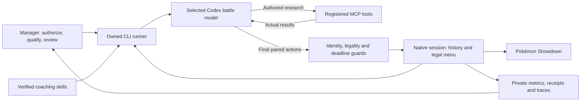

# Architecture

The supported automated battle path is a local Node.js runner using the official
Codex CLI and its ChatGPT sign-in. The same MCP server also supports analysis,
team validation, calculations and private reports without a battle login.

## Decisions and execution

The model owns tactics, research questions and interpretation. The runner does
not choose a plan, fill opposing actions or rank strategies. The manager changes
guidance and tooling between sets, outside the timed decision path.

| Component | Responsibility |
| --- | --- |
| `isolated/runner.mjs` | One-set lifecycle, selected-provider qualification, local MCP connection, source checks and attention handoff. |
| `isolated/attention-alert.mjs` | Small atomic manager alarm before recovery work; no credentials or battle authority. |
| `isolated/codex-cli-provider.mjs` | Owned CLI process, retained per-game context and actual model/tool conversation. No API-key fallback. |
| `isolated/decision-context.mjs` | Complete fresh facts, legal menus, base move metadata and verified guidance. Base priority and reported Speed are not an effective-order calculation. |
| `showdown/agent-session.mjs` | Exact authenticated session/team, controller lease, current requests, bounded research reservations and native commands. |
| `showdown/battle-state.mjs` and `simulation/choice-state.mjs` | Incremental observable battle history, field/lifecycle evidence and source-bound proofs. |
| `planning/tool-client.mjs` | Registered numerical callbacks, cancellation, compatible caching and evidence. |
| `simulation/choice-simulation.mjs` | Mechanical state assembly for one authored pair and labeled hidden-state hypotheses. |
| `simulation/turn-simulator.mjs` | Pinned native Champions engine execution, including effects, RNG and replacement boundaries. |
| `metrics/` and `workflow/` | Exact-team reports, calculation archives, reviews, replay verification and bounded retention. |
| `skills/` | Maintained strategy/mechanics and roster guidance, reviewed and synchronized deliberately. |

## Tool and authority boundaries

The battle model receives eight read-only tools: four mechanics lookups
(`get_pokemon`, `get_move`, `get_ability`, `get_movepool`), three numerical tools
(`calculate_damage`, `calculate_damage_range`, `calculate_speed`) and
`simulate_choices`. The host supplies source/evidence bindings; leases, tokens
and skill receipts are not model-authored arguments. The model has no shell,
filesystem, authentication, search, roster or unrelated connector access.

Current and frozen work share three calculator invocations and one simulation
trajectory per native battle turn. A range call counts its outer invocation and
actual nested calculations. Backend failure or uncertainty spends its reserved
work; a replacement request does not start a new allowance.

Live spread inference reuses only compatible cached checks and starts no new
automatic numerical work. Unknown investments stay assumptions. This leaves the
calculator budget for model-selected tactical questions. Broader explicit
simulation and inference tools remain offline analysis facilities.

## State and uncertainty

Source identity binds session, exact team, room, request and observed state.
History tracking supplies only provable native counters and effects. Current
request HP, moves, PP and legality take precedence over hypotheses.

Reconstruction and legal choice admission are separate. A clickable action is
not rejected by a move/ability support list. Where hidden state or a history gap
prevents exact reconstruction, a conditional native world records each assumed
or omitted field. The engine initializes effects and resolves gameplay; the
adapter restores known facts and preserves the declared random state. No second
damage formula or host-selected tactical outcome is used.

Per-actor last-move observations have a source-bound proof separate from broader
lifecycle confidence. A later audited ordinary move can restore that known field
without restoring uncertain PP or action counters. Receive gaps and relevant
identity/lifecycle resets invalidate its proof; other conditional assumptions
remain visible during reconstruction.

The single result distinguishes completed turns from pending replacement and
queued-action boundaries. Conditional results are not unqualified material
proofs. Finite samples do not establish an exhaustive range or probability.

## Context and waiting-time work

Every fresh game thread receives the full verified matchup folder. Later frames
may reference static content already committed to that same healthy thread;
logical sources still retain the complete bundle. Thread loss, compaction and
uncertain failures invalidate those references. The 8 MiB input bound is separate
from the model's token window and retained-session headroom.

Explicitly authorized pondering runs in a separate read-only process after known
local submission, against an immutable pre-send snapshot. Fresh actions,
execution or uncertainty preempt it. Notes require fresh dependency validation
and material checks; they grant no choice authority or extra research quota.

## Verification and lifecycle

Qualification uses genuine complete saved requests, actual selected-model
generation, model-requested MCP returns, material paired work, same-game
continuity and a fresh sibling thread. Live admission requires the selected
provider's in-process proof; a JSON report is only diagnostic evidence. Changed
source/interfaces require fresh qualification and loaded-hash verification.

One owner retains the original deadline and send reservation. An uncertain write
is reconciled without blind retry. An official child result can supersede a
completed model response; that response remains evidence, not a late action.

The manager supervises the runner directly and monitors its independent attention
alarm. During attention, fresh native ownership evidence can retire a revoked
runner without stopping its successor's client. Unknown observations preserve
uncertainty. Event-class counters and timing buckets distinguish local status
traffic, tool replies and output progress without retaining model text. They do
not establish remote network duration or explain an unobserved provider stall.

After the official parent result and server idle, the runner hands off for
manager review. Verified replays, flushed metrics, a native review checkpoint
and bounded retention precede normal client shutdown. A final static review
check detects late evidence drift. Private team data, access links, receipts and
control capabilities stay out of public documentation and commits.
After a verified attention stop, frozen analysis is archived before process
cleanup. A retired owner never rewrites its successor's shared trace.

See [startup](AGENT-STARTUP.md), [battle workflow](../showdown/AGENT-WORKFLOW.md),
[simulation](SIMULATOR.md) and [metrics](../metrics/README.md) for the contracts.
